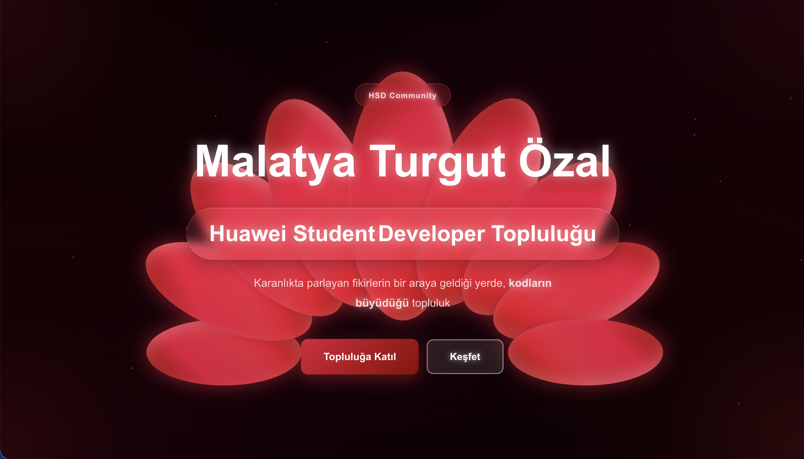
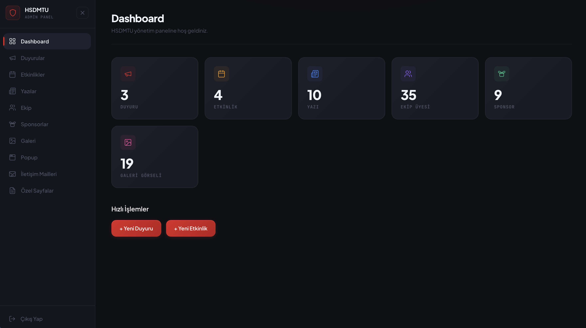

# HSD MTU (Malatya Turgut Özal Üniversitesi) Resmi Web Sitesi



## Proje Hakkında

Bu proje, **Malatya Turgut Özal Üniversitesi HSD (Huawei Student Developers / HSD MTU)** topluluğunun resmi web sitesidir. Üniversite öğrencilerine teknoloji, yazılım geliştirme ve inovasyon alanlarında vizyon katmayı hedefleyen topluluğumuzun dijital yüzüdür. 

Proje, **Mustafa Zahter** tarafından tasarlanmış ve geliştirilmiştir. Modern web teknolojileri (Next.js, TypeScript, Tailwind CSS) kullanılarak, yüksek performanslı ve ölçeklenebilir bir altyapı üzerine inşa edilmiştir.

## Mimari Yaklaşım: FSD (Feature-Sliced Design)

Proje, frontend mimarisi olarak **Feature-Sliced Design (FSD)** metodolojisine katı bir şekilde bağlı kalınarak geliştirilmiştir. Bu sayede kod tabanı:
- **Modüler ve Ölçeklenebilir:** İş mantığı, UI bileşenleri ve veri modelleri katmanlara ayrılarak (`app`, `pages`, `widgets`, `features`, `entities`, `shared`) bağımlılıklar kontrol altına alınmıştır.
- **Sürdürülebilir:** Monolitik yapıdan kaçınılmış, her özellik kendi dilimi (slice) içinde izole edilmiştir.
- **Güçlü Bağımlılık Akışı:** Sadece alt katmanlara doğru içe aktarım (import) yapılmasına izin veren yapı sayesinde spaghetti kod oluşumu engellenmiştir.

## Performans ve Optimizasyonlar (Frozen Mechanism)

Sitede yüksek düzeyde optimize edilmiş bir "Sıfır Atık Kaynak Kullanımı" politikası uygulanmaktadır. Özellikle animasyonların ve ağır bileşenlerin performansı etkilememesi için gelişmiş mekanizmalar kullanılmıştır:

- **Frozen (Dondurulmuş) Mimarisi:** Görünüm alanında (viewport) olmayan tüm section'lar dondurulur. Intersection Observer kullanılarak, sadece kullanıcının gördüğü ve hemen altı/üstü komşu olan bölgelere CPU/GPU kaynağı ayrılır.
- **Background Throttling:** Sekme arka plana alındığında (`document.hidden`), GSAP gibi animasyon motorları ve CSS animasyonları otomatik olarak duraklatılır (`animation-play-state: paused`).
- **Gereksiz Render Engelleme:** `requestAnimationFrame` ve Three.js/WebGL döngüleri, `useFrozen` kancası ile bileşenler ekran dışındayken tamamen durdurulur.

## Site Bölümleri (Sections)

Web sitesi, kullanıcı deneyimini en üst seviyeye çıkarmak için özenle tasarlanmış bölümlerden oluşur:
- **Hero (Ana Ekran):** Topluluğun vizyonunu yansıtan, etkileyici ve animasyonlu başlangıç ekranı.
- **Hakkımızda:** HSD MTU'nun misyonu, vizyonu ve hedefleri.
- **Etkinlikler:** Yaklaşan ve geçmiş hackathon'lar, workshop'lar ve tech talk serileri.
- **Projeler:** Topluluk üyelerinin geliştirdiği inovatif projelerin sergilendiği alan.
- **Yönetim Kurulu / Ekip:** Topluluğu ileriye taşıyan çekirdek kadro.
- **İletişim:** Sponsorluk, katılım ve işbirlikleri için iletişim formu.

---

## Admin Panel



### Admin Panel Özellikleri

Sitenin dinamik yapısını yönetmek için özel olarak tasarlanmış gelişmiş bir yönetici paneli bulunmaktadır. Bu panel sayesinde koda müdahale etmeden site içerikleri anında güncellenebilmektedir:

- **Etkinlik Yönetimi:** Yeni etkinlik (workshop, eğitim, yarışma) oluşturma, tarih/saat belirleme ve etkinlik detaylarını düzenleme.
- **Ekip Yönetimi:** Yönetim kurulu ve aktif üye listesini güncelleme, yeni üyeler ekleme veya görev değişikliklerini anında yansıtma.
- **Duyurular ve İçerik Yönetimi:** Site üzerinden kullanıcılara anlık duyurular geçebilme ve site metinlerini düzenleme.
- **Galeri ve Görsel Yönetimi:** Etkinlik fotoğraflarının, sponsor logolarının ve projelerin sisteme kolayca yüklenip yönetilmesi.
- **Gelişmiş Metrikler ve Gelen Kutusu:** Sitenin etkileşimlerini, iletişim formundan gelen mesajları okuma ve yanıtlama imkanı.
- **Güvenli Erişim Kontrolü:** Sadece yetkilendirilmiş yönetim ekibinin erişebildiği, JWT/Session tabanlı güvenli kimlik doğrulama altyapısı.

---

## Kurulum ve Başlatma

### Gereksinimler
- Node.js 18+
- pnpm (tercih edilen) veya npm/yarn

```bash
# Projeyi klonlayın ve bağımlılıkları yükleyin
pnpm install

# Geliştirme sunucusunu başlatın
pnpm run dev
```

Tarayıcınızda [http://localhost:3000](http://localhost:3000) adresini açarak projeyi görüntüleyebilirsiniz.

---
© 2026 HSD Malatya Turgut Özal Topluluğu
